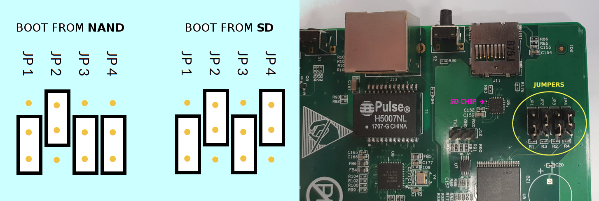

<div align="center">

```text
  ____   ___        _   _           _       ___  ____  
 / ___| / _ \      | \ | | ___   __| | ___ / _ \/ ___| 
 \___ \| (_) |_____|  \| |/ _ \ / _` |/ _ \ | | \___ \ 
  ___) |\__, |_____| |\  | (_) | (_| |  __/ |_| |___) |
 |____/   /_/      |_| \_|\___/ \__,_|\___|\___/|____/ 
```

# S9-NodeOS

**Turn Repurposed Antminer S9 Control Boards into Silent, Ultra-Low-Power Debian 12 Linux Servers & Cluster Nodes**

[](https://www.debian.org/)
[-0071C5?style=for-the-badge&logo=arm&logoColor=white)](#technical-specifications)
[](#key-features)
[](https://github.com/ParrotRex/S9-NodeOS/releases)

[Download Latest Release](https://github.com/ParrotRex/S9-NodeOS/releases) • [Hardware Jumper Guide](#step-1-configure-control-board-jumpers) • [Quick Start](#installation--quick-start) • [Web Dashboard](#built-in-web-telemetry-dashboard)

</div>

---

## Overview

Millions of **Antminer S9** control boards powered by the **Xilinx Zynq-7010** (Dual-Core ARM Cortex-A9 + FPGA) sit unused today. While capable of running real Linux workloads silently at just a few watts, running modern distributions on them has historically been difficult because mainline kernels lack the board's proprietary FPGA bitstream, while stock miner firmwares are outdated and locked down.

**S9-NodeOS** bridges this gap with a clean **hybrid architecture**:

1. **Proven Hardware & Kernel Layer:** Uses the battle-tested Zynq bootloader (`boot.bin`, `u-boot.img`), FPGA bitstream (`system.bit.gz`), Device Tree, and `Linux 4.4.0-xilinx` kernel packaged into a clean FIT image—guaranteeing rock-solid Ethernet, GPIO LEDs, and internal XADC die temperature readings.
2. **Genuine Debian 12 (`bookworm`) Userland:** Bootstrapped directly from official Debian mirrors (`deb.debian.org`) with lightweight `sysvinit-core` instead of heavy `systemd`, cutting idle memory usage to **~31 MB** while giving you full `apt` package access.

> [!IMPORTANT]
> **100% Safe & Non-Destructive (MicroSD Only)**  
> S9-NodeOS boots and runs **exclusively from your MicroSD card**. It never touches, formats, or overwrites your control board's internal NAND flash. To restore your original miner firmware at any time, simply power off, remove the MicroSD card, and move the boot jumper back to `NAND`.

---

## Stock Firmware vs. S9-NodeOS

| Feature | Stock Miner / Legacy Firmware | **S9-NodeOS v1.0** |
| :--- | :--- | :--- |
| **Operating System** | Locked-down / Outdated OpenWrt | **Debian 12 (Bookworm) `armhf`** |
| **Package Manager** | Limited or broken feeds | **Full official Debian `apt` repositories** |
| **Idle Memory Footprint** | ~90–140 MB | **~31 MB** (+ **256 MB ZRAM** compressed swap) |
| **Storage Expansion** | Fixed small partition | **Auto-expands** to full MicroSD size on first boot |
| **Cluster Readiness** | Identical hostnames & random MACs | **Auto-unique hostname (`s9-node-xxxx`) & persistent MAC** |
| **Monitoring** | Miner-only hashboard UI | **Built-in Web Telemetry Dashboard (`:8080`)** |

---

## Installation & Quick Start

### Step 1: Configure Control Board Jumpers

By default, Antminer S9 control boards boot from internal **NAND** memory and will ignore the MicroSD slot until you switch the jumper configuration:

1. **Disconnect 12V power** completely from the control board.
2. Locate the 4 jumper headers (**`JP1`**, **`JP2`**, **`JP3`**, **`JP4`**) next to the MicroSD card slot (`J11`).
3. Move **`JP4`** from the bottom two pins (`NAND`) to the **top two pins (`SD`)** as shown below:

<div align="center">
  
</div>

<br>

| Jumper | Boot from NAND (Default) | **Boot from MicroSD (Required)** |
| :---: | :---: | :---: |
| **JP1** | Bottom 2 pins | Bottom 2 pins |
| **JP2** | Top 2 pins | Top 2 pins |
| **JP3** | Bottom 2 pins | Bottom 2 pins |
| **JP4** | Bottom 2 pins | **Top 2 pins** |

---

### Step 2: Flash S9-NodeOS to a MicroSD Card

1. Download **`S9-NodeOS-v1.0-armhf.img.xz`** from the [Releases](https://github.com/ParrotRex/S9-NodeOS/releases) page.
2. Insert a healthy **MicroSD card (4 GB or larger)** into your PC.
3. Open **[Rufus](https://rufus.ie/)** (Windows) or **[BalenaEtcher](https://etcher.balena.io/)** (Windows/Linux/macOS), select the `.img.xz` file directly (no manual extraction required), and flash it to your card.

---

### Step 3: Boot & Verify Hardware LEDs

1. Insert the flashed MicroSD card into the control board slot.
2. Connect an Ethernet cable to your router/switch, then connect **12V power** (via barrel jack or 6-pin PCIe connector).
3. Wait **~30 seconds** for first-boot initialization (partition expansion, SSH key generation, and network lease):
   - **Booting:** Both Red and Green LEDs stay solid.
   - **Ready:** The **Red LED turns OFF** and the **Green LED pulses** with a steady heartbeat.

---

### Step 4: Connect via Web Dashboard or SSH

Check your router's DHCP client list for a device named **`s9-node-xxxx`** (where `xxxx` is derived from your board's MAC address):

- **Web Monitoring Dashboard:**  
  Open your browser and navigate to:
  ```text
  http://<BOARD_IP>:8080
  ```

- **SSH Terminal Access:**  
  ```bash
  ssh root@<BOARD_IP>
  ```
  - **Default Username:** `root`
  - **Default Password:** `root`

> [!TIP]
> **First Login Security:** Immediately change the default password after logging in via SSH by running `passwd`.

---

## Built-in Web Telemetry Dashboard

S9-NodeOS includes a zero-dependency, ultra-lightweight Python telemetry agent running on port **`8080`** (< 8 MB RAM usage) featuring:
- Real-time **Dual-Core CPU Load** & Load Averages
- **Memory & ZRAM Swap** utilization
- Live **Zynq-7010 SoC Die Temperature** read directly from the internal XADC sensor
- **MicroSD Storage** capacity & usage bar
- **Network Throughput** (`RX` / `TX` KB/s), IPv4, and persistent MAC address
- **Blink LEDs Locator:** Flashes the onboard LEDs on demand so you can physically identify a specific board in a multi-node rack or cluster

---

## Technical Specifications

| Component | Details |
| :--- | :--- |
| **Supported Hardware** | Antminer S9 / S9i / S9j Control Boards (Xilinx Zynq-7010) |
| **CPU Architecture** | Dual-Core ARM Cortex-A9 (`armv7l` / `armhf`) |
| **Memory** | 512 MB DDR3 + 256 MB ZRAM Compressed Swap |
| **Base Distribution** | Debian 12 (`bookworm`) Minimal |
| **Kernel** | `Linux 4.4.0-xilinx` (FIT Image + FPGA Bitstream) |
| **Init System** | `sysvinit-core` |
| **Network** | 100/1000 Mbps Ethernet (`eth0` via `udhcpc` with persistent MAC lock) |

---

## Troubleshooting & FAQ

<details>
<summary><b>Both Red and Green LEDs stay solid and the board doesn't appear in my router</b></summary>
<br>
1. Double-check that <b>JP4</b> is bridged on the <b>top two pins (SD)</b> and that power was disconnected while moving the jumper.<br>
2. Try a different MicroSD card—older or worn-out cards often fail silently during boot on Zynq controllers.
</details>

<details>
<summary><b>How do I switch back to the original Antminer firmware?</b></summary>
<br>
Power off the board, remove the MicroSD card, and move <b>JP4</b> back to the <b>bottom two pins (NAND)</b>. Your original firmware remains completely untouched.
</details>

<details>
<summary><b>Can I run multiple S9 boards together as a cluster?</b></summary>
<br>
Yes! On first boot, each board automatically locks its own unique MAC address, generates a unique hostname (<code>s9-node-xxxx</code>), and creates unique SSH host keys so multiple nodes never collide on the same network.
</details>

---

## Author & License

Created and maintained by **[ParrotRex (Mohammad)](https://github.com/ParrotRex)**.  
Released under the **MIT License** — contributions, issues, and pull requests are welcome!
